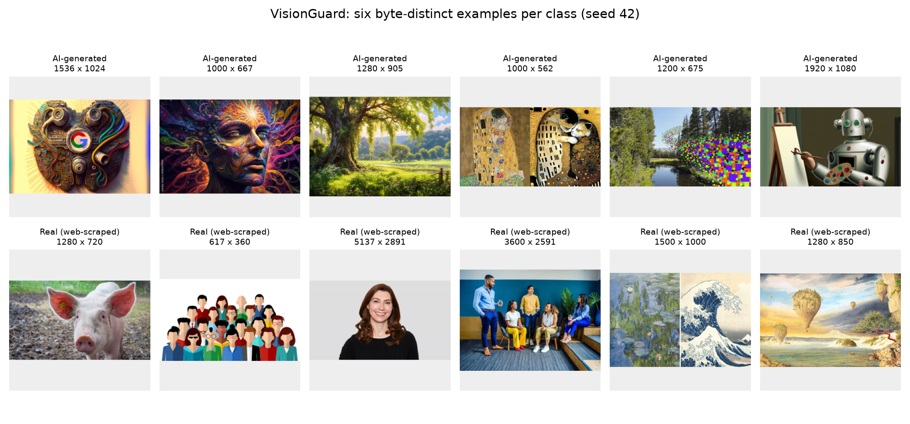
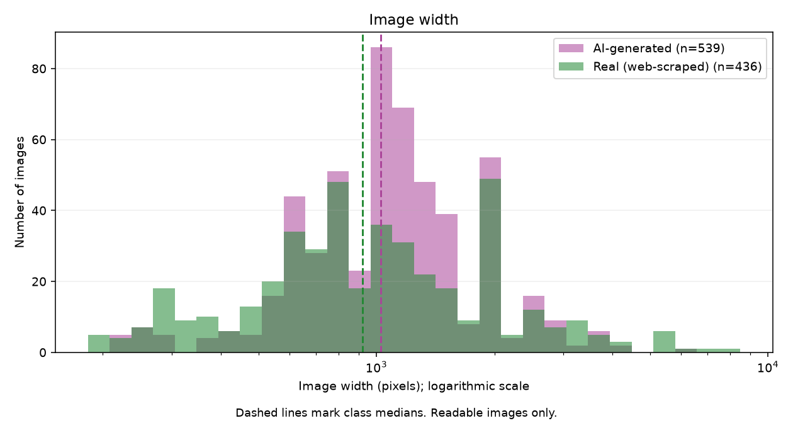
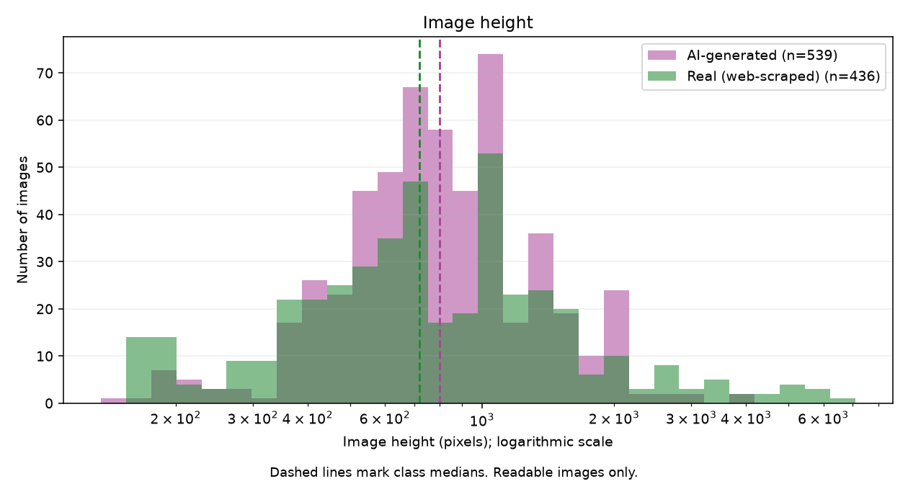
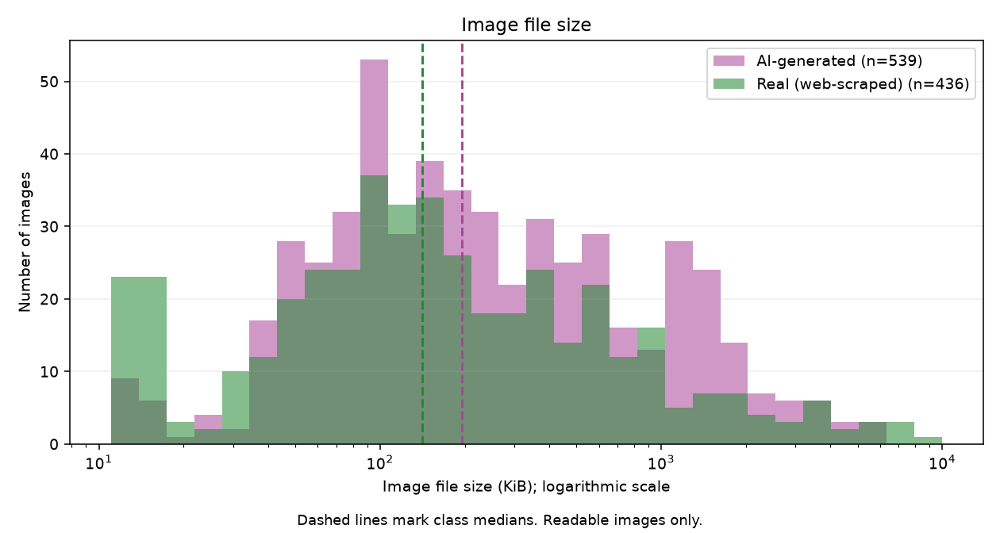

# VisionGuard dataset audit

Audit time: 2026-10-24T17:54:11.824327+05:00. Raw files were inspected without modification.

## Counts and integrity

| Class | Files | Readable | Unreadable | Total MiB |
| --- | ---: | ---: | ---: | ---: |
| AI-generated | 539 | 539 | 0 | 274.73 |
| Real (web-scraped) | 436 | 436 | 0 | 205.72 |

SHA-256 exact-duplicate groups: **1**; files belonging to those groups: **2**; redundant copies beyond one file per hash: **1**; cross-class duplicate groups: **0**.

Duplicate counts refer to identical file bytes, not visually similar images. Originals and duplicates remain intact in data/raw. Keep each duplicate group in a single split, or deduplicate before splitting; inspect conflicting labels before choosing a class.

## Dimensions and file size

| Class | Quantity | Minimum | Median | Maximum |
| --- | --- | ---: | ---: | ---: |
| AI-generated | Width (px) | 225 | 1,024 | 6,000 |
| AI-generated | Height (px) | 135 | 800 | 4,001 |
| AI-generated | File size (bytes) | 11,738 | 199,760 | 5,626,183 |
| Real (web-scraped) | Width (px) | 183 | 920 | 8,495 |
| Real (web-scraped) | Height (px) | 158 | 720 | 7,091 |
| Real (web-scraped) | File size (bytes) | 11,311 | 144,840 | 10,195,352 |

Dimension statistics and figures use readable images only; file-size statistics above include every audited file. Width and height are encoded dimensions before EXIF orientation handling. Every file has its original SHA-256, class, size, detected format/mode, readability status and duplicate flags in image_manifest.csv.

## Visual exploration

Figure 1. Six readable, byte-distinct examples per class were sampled with seed 42; display thumbnails preserve aspect ratio and apply EXIF orientation. The real-labeled content includes illustrations and paintings as well as photographs, so the task is broader than distinguishing AI images from photographs alone. Labels come from source folders and are not independently verified ground truth.

Figure 2. The class width distributions have medians of AI-generated: 1024; Real (web-scraped): 920 (pixels); the dashed lines mark those medians. A fixed training input width is necessary; choose resizing and padding/cropping deliberately to avoid unintended distortion.

Figure 3. The class height distributions have medians of AI-generated: 800; Real (web-scraped): 720 (pixels); the dashed lines mark those medians. Inspect aspect ratios as well as height before selecting the model preprocessing policy.

Figure 4. The class file size distributions have medians of AI-generated: 199760; Real (web-scraped): 144840 (bytes); the dashed lines mark those medians. File size is an encoding/storage property, not a reliable authenticity label, so the model should learn image content rather than file metadata.

## Formats, colour modes and shapes

- **AI-generated:** formats {"JPEG": 429, "PNG": 110}; colour modes {"RGB": 489, "P": 14, "RGBA": 35, "L": 1}; landscape/portrait/square = 369/51/119.
- **Real (web-scraped):** formats {"JPEG": 403, "PNG": 33}; colour modes {"RGB": 407, "P": 9, "L": 6, "RGBA": 14}; landscape/portrait/square = 307/93/36.

## Findings that affect preparation

- **Class balance:** AI-generated content represents 55.3% of raw files. Preserve class proportions in the eventual splits and report precision/recall/F1 alongside accuracy.
- **Colour handling:** 79 images use palette, grayscale or RGBA modes. Convert inputs consistently to RGB, with an explicit alpha-compositing policy shared by training and serving.
- **Resolution and aspect ratio:** image dimensions vary widely and include landscape, portrait and square images. Choose a bounded input size and document the aspect-ratio policy before training.
- **Labels and scope:** the real-labeled folder includes photographs and artwork. Do not treat artistic appearance as proof of AI generation or present this small source dataset as independent verification of every label.
- **Duplicate handling:** preserve the raw source and exclude redundant copies through a deterministic split manifest, or group duplicates into one split. Do not let identical bytes appear in both training and evaluation sets.

## Reproducibility and storage

Dataset fingerprint: `ccf9e412522a4da9cb0f9b8d01c5f9e27ba44b30118e3c9f731b21e5d6b2d793`. This hashes sorted relative paths, labels and each original file's SHA-256.

Free space after the audit: **6.53 GiB**. Required reserve: **2.00 GiB**. Download version, archive SHA-256, CRC verification and peak-space measurements are in dataset_source.json.

The next step is to decide duplicate handling and make reproducible class-stratified train/validation/test lists. No split, training or original-file deletion was performed by this audit.
