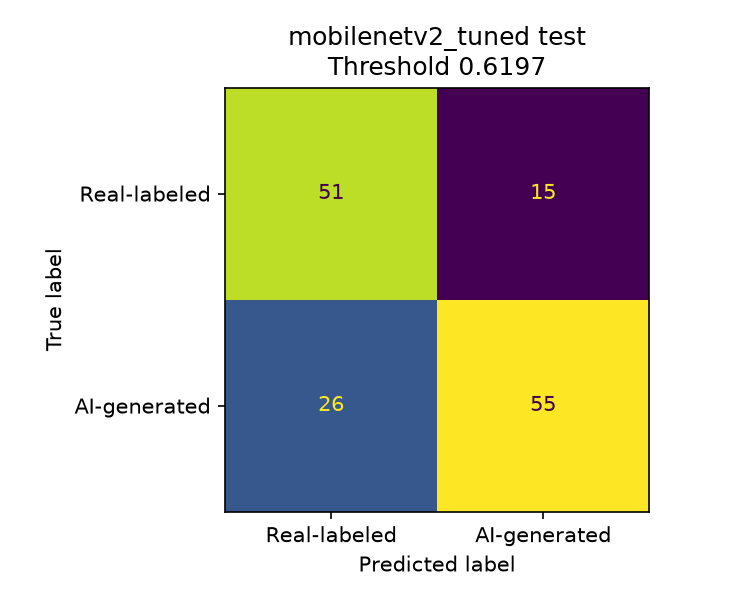
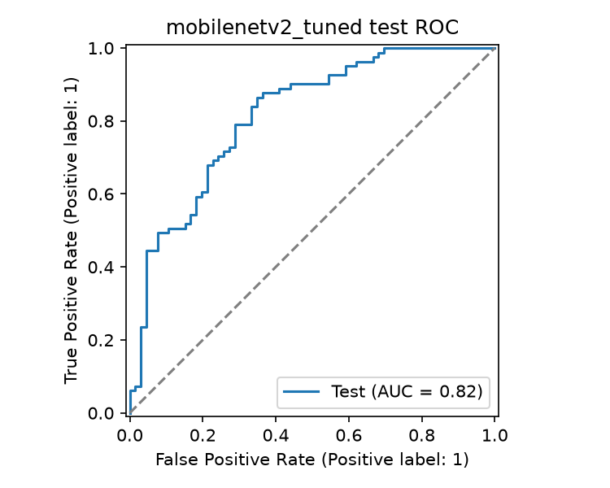
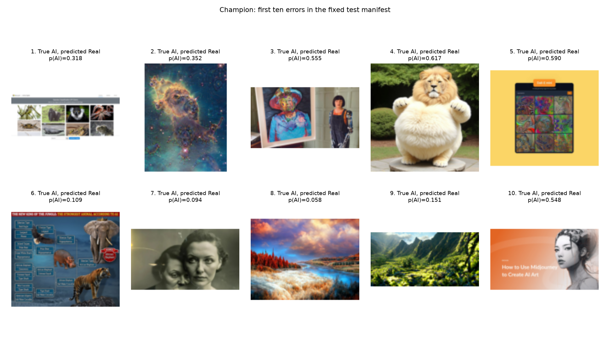

# Final model evaluation

The tuned MobileNetV2 was selected from 11 candidates by minimum validation
cross-entropy. Its weights and decision threshold were committed before the
test pass in `1ecf521`. No test result was used to select or adjust the model.

The threshold is **0.6196606457233429**, selected on validation to minimize
`2 * false positives + false negatives`. Calling a real-labeled image fake is
treated as twice as costly as missing an AI image. This is an explicit product
assumption. At this threshold, validation accuracy was 80.82%, precision 86.30%,
recall 77.78%, F1 0.8182 and ROC AUC 0.8663.

## Final test results

Each of the two locked models received one inference pass on the same 147 test
images: 66 real-labeled and 81 AI-generated. This completes the assignment's
CNN/transfer comparison. Subsequent reports and uploads use the saved probabilities.

| Model | Threshold | Accuracy | Precision | Recall | F1 | ROC AUC | Loss |
| --- | --- | --- | --- | --- | --- | --- | --- |
| cnn_baseline | 0.472560 | 40.14% | 23.08% | 3.70% | 0.0638 | 0.4669 | 0.7015 |
| mobilenetv2_tuned | 0.619661 | 72.11% | 78.57% | 67.90% | 0.7285 | 0.8161 | 0.6090 |

The champion confusion matrix is TN 51, FP 15, FN 26 and TP 55. Its weighted
error count is 56. The CNN produced TN 56, FP 10, FN 78 and TP 3, with weighted
error count 98. Always predicting real would have weighted error count 81.
The CNN is a weak baseline, and its poor result is retained.

Champion accuracy fell from 80.82% on validation to 72.11% on test. The test
set is small, the tuning process repeatedly reused validation, and the data
contain varied artwork, photographs, composites and screenshots. These results
do not establish image provenance or general performance on arbitrary uploads.
The locked threshold and model remain unchanged after seeing these results.

## Ten misclassified examples

These are the first ten errors in the fixed manifest, not a representative
sample of all errors. All ten are false negatives because AI-labeled files come
first in this manifest. There are also 15 false positives in the full results.
Images are displayed with the same RGB letterbox preprocessing used by the model.
The labels below are dataset folder labels, not independently verified provenance.

| Example | Visual observation and possible explanation |
| --- | --- |
| 1 | A web-page screenshot contains several animal photographs and large margins. The model may follow the photograph and page-layout cues rather than generated content. |
| 2 | A nebula-like cloud scene has a painterly texture. Such styles overlap with real-labeled artwork, making the folder distinction difficult. |
| 3 | A person stands beside framed artwork. Most of the frame has photographic context, which may dominate the artwork region. |
| 4 | A fluffy animal has familiar fur and garden textures. Its score 0.617 is just below the conservative threshold of 0.620. |
| 5 | A product-page graphic has a large yellow background, interface elements and small artworks. Resizing may suppress useful local detail. |
| 6 | An infographic mixes text with several animal cutouts. The broad composition differs from an isolated generated image and may reflect weak folder-level labeling. |
| 7 | A monochrome portrait has grain and a photographic appearance. The model may associate these cues with the real-labeled class. |
| 8 | A saturated lake-and-cloud landscape has ordinary scene structure. Natural textures and real-labeled artwork may overlap with this style. |
| 9 | A mountain landscape contains vegetation and plausible photographic depth. Semantic scene cues may outweigh generation artifacts. |
| 10 | A promotional banner mixes text, a background graphic and a portrait. The score 0.548 falls below the locked cost-based threshold. |

These are visual hypotheses, not explanations established by attribution or
causal experiments. They motivate a future independent dataset audit; they are
not used to alter this evaluation or its decision threshold.

## Registry and reproducibility

DagsHub MLflow model `23L-0907_A2_Ops` contains frozen MobileNetV2 as version 1
and tuned MobileNetV2 as version 2. The `champion` alias points to version 2.
Each version records its validation-derived threshold and preprocessing policy.
The separate registry example uses a validation image and does not reopen test
evaluation. The serving bundle contains `best.keras` and `policy.json` and is
versioned through `models/champion.dvc`.

The receipts bind each saved probability vector to model SHA-256, test manifest
SHA-256, threshold and selection-plan SHA-256. Each records one inference pass.
The ignored durable runtime ledger refuses a second pass or changed identity.
Confusion matrices, ROC curves and CSVs are derived from those same probabilities.

Reporting checks corrected the prediction CSV exporter to use the locked
threshold; the original metrics were already computed with that threshold.
The corrected CSVs and the adjusted figure layout were produced from saved
probabilities without repeating test inference.
